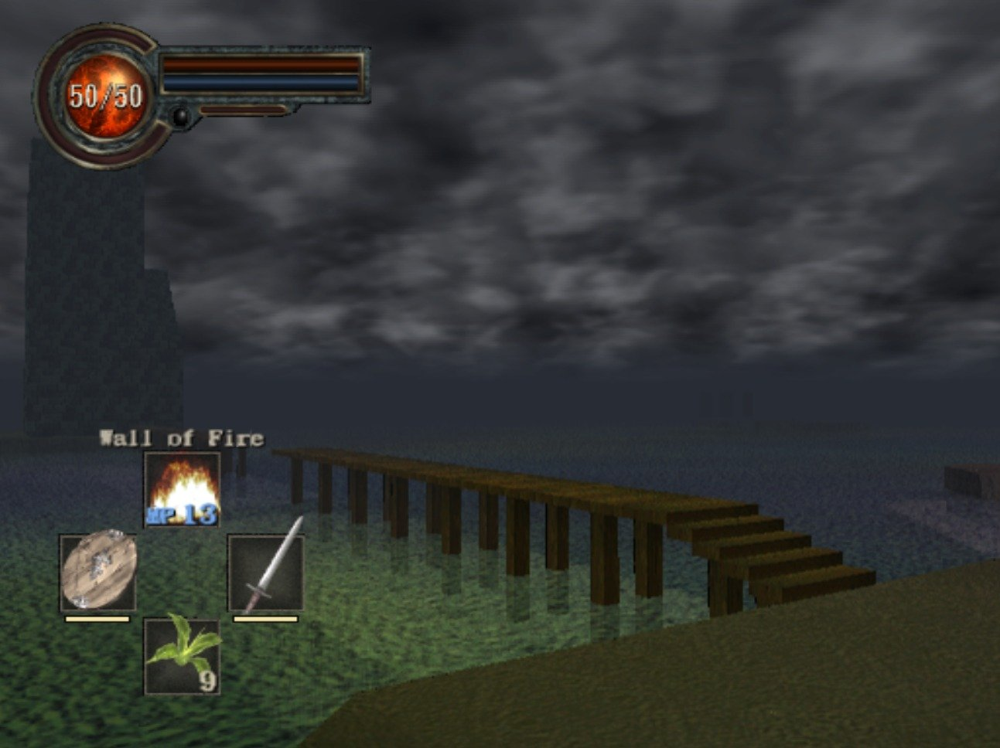
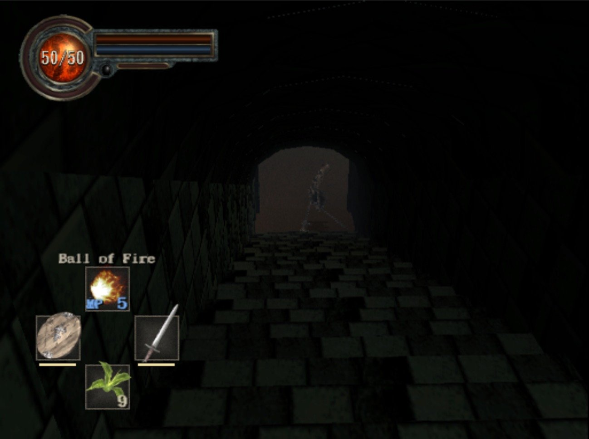
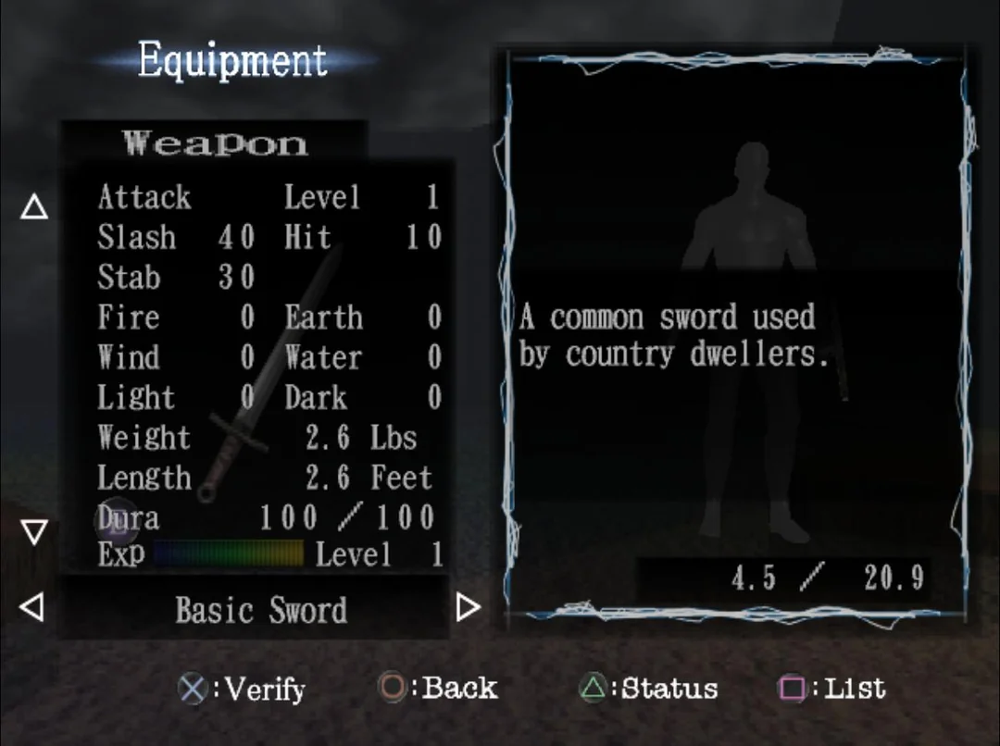
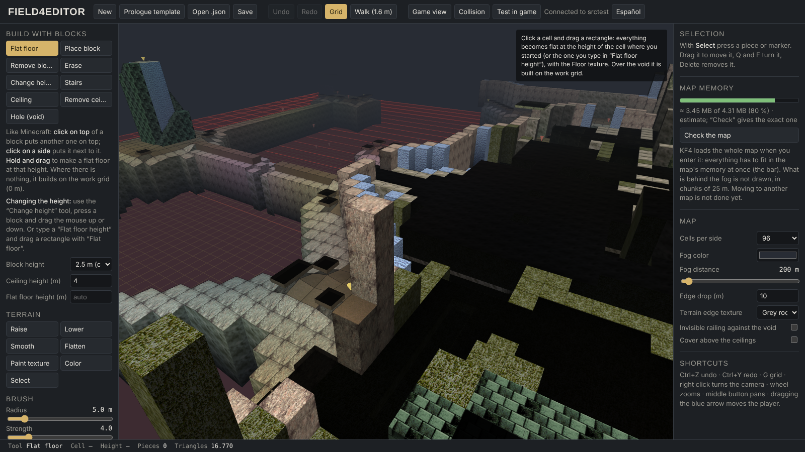

# FIELDIV-ENGINE — Alpha 0.1

Tools for **King's Field IV** (PS2, PAL `SLES-50920`): a map generator that ports levels from the original
King's Field games into KFIV, a map editor, and a HUD / controls patch.

> **AI disclosure:** most of the code in this repository was written with Claude (Anthropic's AI), directed,
> play-tested and iterated on by me in PCSX2. It builds on the community's reverse-engineering work (see Credits).



## What it does

- **King's Field levels inside KFIV**: real geometry, textures and decor from the original game, with collision.
- **Secret walls, doors, chests, barrels and the healing fountain**, working with KFIV's own objects and scripts.
- **HUD patch**: HP number in the orb, a cross HUD for magic and items, weapon EXP in the equipment screen.
- **Optional twin-stick controls.**
- **Choose your starting gear** (`engine/equipo_inicial.txt`).

| In game | Equipment screen with weapon EXP |
|---|---|
|  |  |

### Field4Editor (map editor)

Early stage: English by default, with an English / Español button.



## Download and use

1. Download **FIELDIV-ENGINE.zip** from [Releases](../../releases) and unzip it.
2. Put **your own** King's Field IV ISO next to `FIELDIV-ENGINE.exe`.
3. Open `FIELDIV-ENGINE.exe` and pick an option:
   - port a King's Field level and play it,
   - Field4Editor (map editor),
   - cliff valley,
   - HUD / controls patch only (writes a patched copy; your original ISO is not changed),
   - changelog.

```
FIELDIV-ENGINE\
  FIELDIV-ENGINE.exe
  CHANGELOG.txt
  engine\          the tools (.bat + Python)
  King's Field IV.iso   <- yours
```

### Requirements

- Windows, [Python 3](https://www.python.org/) ("Add Python to PATH"). The tools install `numpy` and `Pillow` the
  first time. The .exe is only the menu: the tools themselves run on Python.
- [PCSX2](https://pcsx2.net/).
- Your own copy of King's Field IV (PAL), and of King's Field for the level port. **No game data is included.**

The tools' messages are mostly in Spanish.

## Support

If you want to help keep the project going: [ko-fi.com/cimentacion](https://ko-fi.com/cimentacion).
It's a free, non-commercial fan project; donations are optional.

## Credits

- [KingsFieldRE / KFModTool](https://github.com/IvanDSM/KingsFieldRE) — King's Field formats and object IDs.
- [kfiv-decomp](https://github.com/Voicedrew11/kfiv-decomp) — King's Field IV decompilation.
- FromSoftware, for King's Field. Non-commercial fan project, not affiliated with FromSoftware.

## Changelog

See [CHANGELOG.txt](CHANGELOG.txt).
