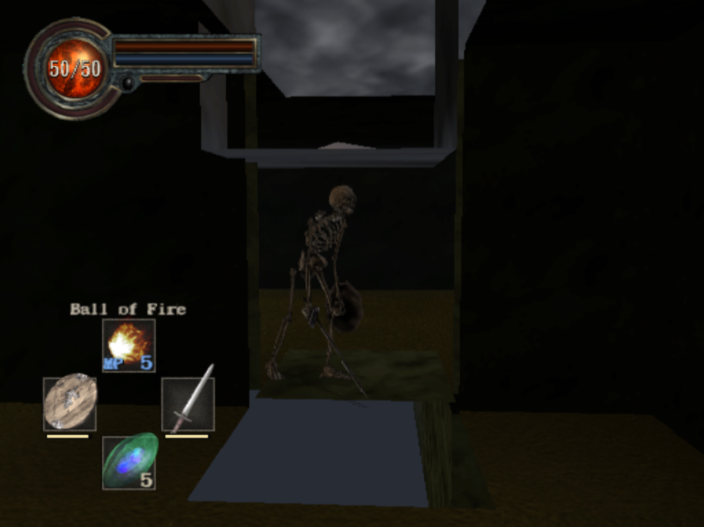
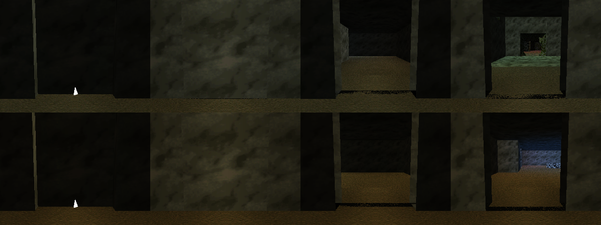
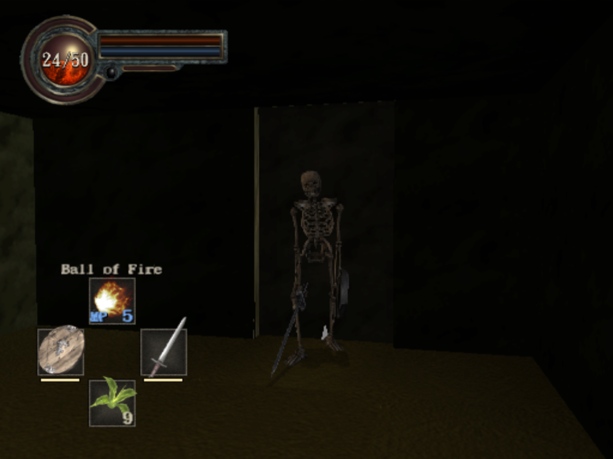

# FIELDIV-ENGINE — Alpha 0.1

Tools for **King's Field IV** (PS2, PAL `SLES-50920`): a map generator that ports levels from the original
King's Field games into KFIV, a map editor, and a HUD / controls patch.

> **AI disclosure:** most of the code in this repository was written with Claude (Anthropic's AI), directed,
> play-tested and iterated on by me in PCSX2. It builds on the community's reverse-engineering work (see Credits).

## What it does

- **King's Field levels inside KFIV**: real geometry, textures and decor from the original game, with collision.
- **Secret walls, doors, chests, barrels and the healing fountain**, working with KFIV's own objects and scripts.
- **HUD patch**: HP number in the orb, a cross HUD for magic and items, weapon EXP in the equipment screen.
- **Optional twin-stick controls.**
- **Choose your starting gear** (`equipo_inicial.txt`).

| Secret wall (render: closed / raised) | In game |
|---|---|
|  |  |

## Requirements

- Windows, [Python 3](https://www.python.org/) ("Add Python to PATH"); the .bat files install `numpy` and `Pillow`.
- [PCSX2](https://pcsx2.net/).
- **Your own copy** of King's Field IV (PAL). For the level port, the files of your own copy of King's Field.
  No game data is included here, and none should ever be uploaded.

## Usage

- `PARCHE_HUD.bat` — only the HUD / controls patch: drag your ISO onto it. It writes a patched copy and leaves
  your original untouched.
- `JUGAR_KF2.bat` — ports a King's Field level, lets you pick your starting gear, builds the map and opens the game.
- `EDITOR.bat` — the map editor (`editor_torre.html`).
- `JUGAR_VALLE.bat` — builds the procedural cliff valley instead.

The scripts and messages are mostly in Spanish.

## Credits

- [KingsFieldRE / KFModTool](https://github.com/IvanDSM/KingsFieldRE) — King's Field formats and object IDs.
- [kfiv-decomp](https://github.com/Voicedrew11/kfiv-decomp) — King's Field IV decompilation.
- FromSoftware, for King's Field. This is a non-commercial fan project, not affiliated with FromSoftware.

## Changelog

See [CHANGELOG.md](CHANGELOG.md).
